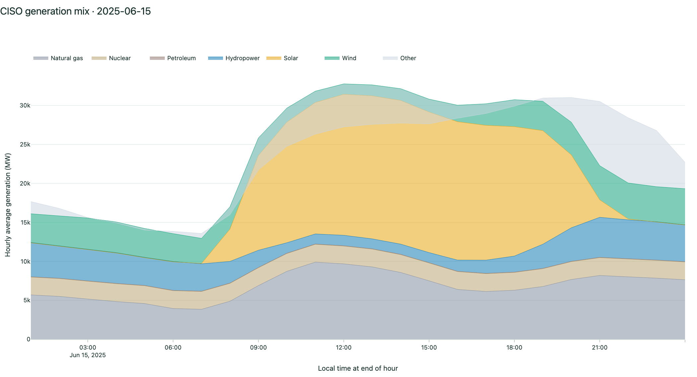
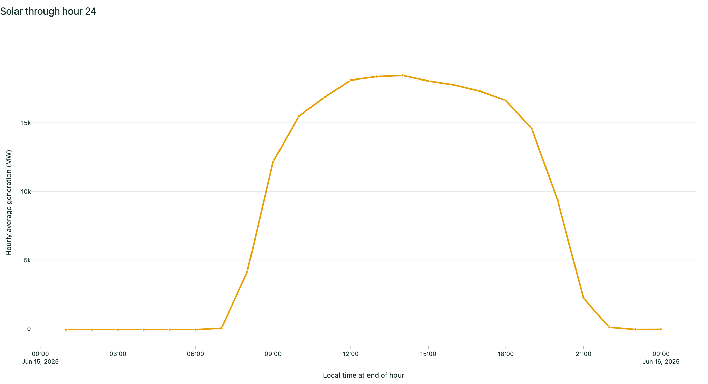
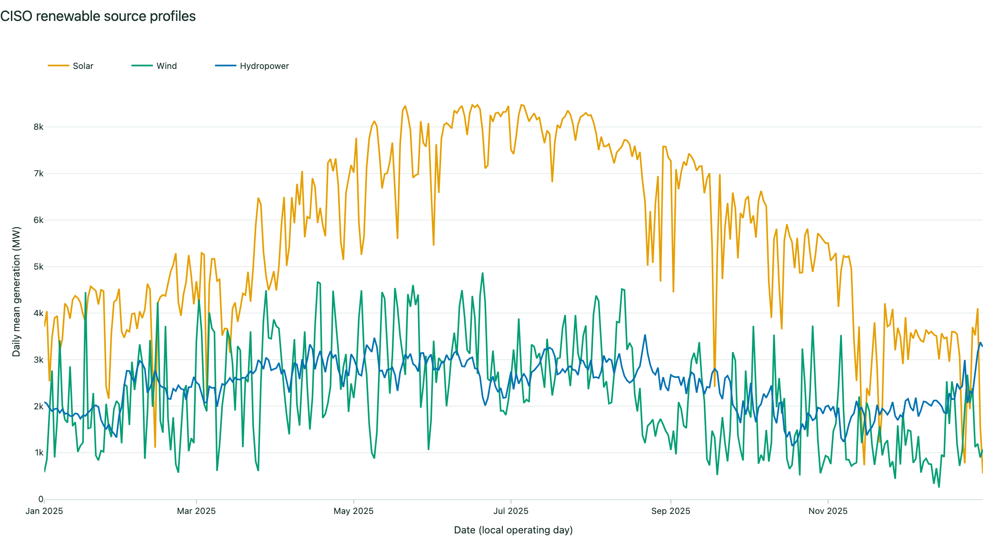
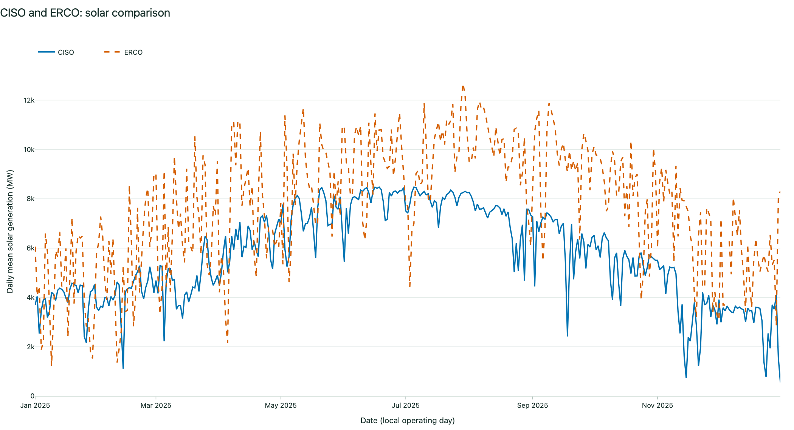
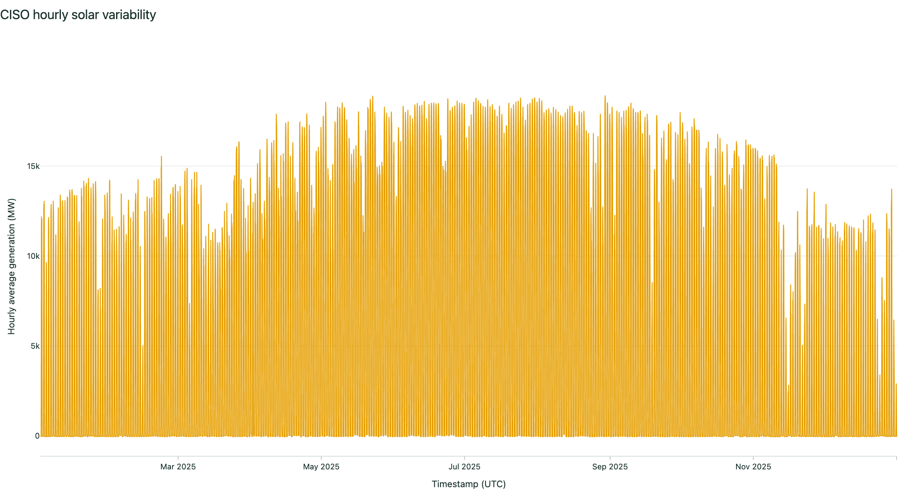
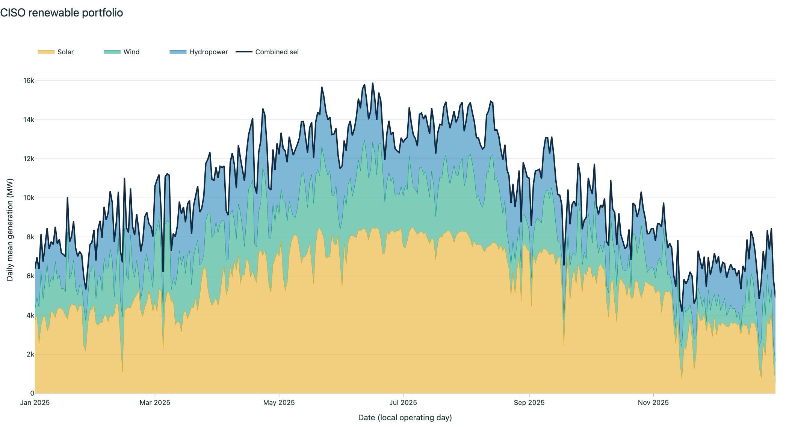

# The Renewable Grid, Hour by Hour

**Shazab Ali**  
**Final academic report**  
**Data period:** January 1–December 31, 2025  
**Source code:** <https://github.com/shaz1234567/renewable-grid-story>  
**Working visualization:** <https://renewable-grid-story.onrender.com/>

## Abstract

This project is a six-view interactive scientific story about how solar, wind, and hydropower vary through a day, across a year, and among four U.S. balancing authorities: California ISO (CISO), Electric Reliability Council of Texas (ERCO), New York ISO (NYIS), and PJM. The implemented Plotly Dash application uses 35,040 hourly authority records derived from the U.S. Energy Information Administration (EIA) Form 930 for 2025. It combines daily generation-mix context, stepwise hourly playback, annual source profiles, matched-period regional comparisons, variability statistics, and renewable-portfolio analysis. Annual renewable energy and shares of net generation were 90.819 million MWh and 48.744% for CISO, 182.821 million MWh and 37.583% for ERCO, 31.137 million MWh and 23.500% for NYIS, and 72.299 million MWh and 8.255% for PJM. Validation passed 10 of 11 checks. Coverage, timestamps, provenance, and aggregation arithmetic passed, but the dataset contains **31 missing renewables rows and 31 missing generation-mix rows**; therefore validation is not described as entirely clean. Automated tests cover 20 cases. One documented visual review produced a title/legend readability revision; broader target-audience comprehension testing remains pending.

## 1. Introduction

### Research question

How can an interactive visual narrative make the temporal and regional differences among solar, wind, and hydropower understandable without hiding scale, variability, missing data, or the limits of descriptive comparisons?

### Audience

The primary audience is university students and instructors who understand basic charts but may not know electricity-system terminology. A secondary audience is an interested public reader seeking a concise, evidence-based introduction to balancing-authority generation patterns. The application explains units, limits causal claims, exposes missingness, and presents both absolute and normalized scales.

### Objectives

1. Show an ordinary operating day in the context of the full reported generation mix.
2. Let a reader reveal one renewable source hour by hour rather than seeing only a completed line.
3. Expose annual and seasonal structure using daily means.
4. Compare the same source and date interval across two authorities, in raw MW or normalized form.
5. Quantify mean, extrema, sample standard deviation, coefficient of variation (CV), and missing hours.
6. Test whether a selected renewable portfolio is steadier relative to its mean than its component sources.
7. Preserve source gaps and disclose methodological boundaries instead of implying forecast or causal evidence.

### Proposal alignment and documented changes

The submitted proposal was approved with the instructor comment **“approved”** and no requested revisions. The implementation therefore preserves the approved central question, 2025 scope, four balancing authorities, three renewable source families, and six-view storyboard. The following implementation changes were necessary and retain the proposal’s scientific intent:

1. Because EIA API-key registration returned “access denied,” acquisition uses the key-free, versioned EIA-930 bulk archives. Checksums and a fixed Zenodo record make this route more reproducible than a live API dependency.
2. The 2025 EIA schema splits solar and wind into categories with and without integrated storage. The pipeline transparently combines each source family, uses hydro excluding pumped storage, and excludes standalone and pumped storage.
3. Plotly Dash was selected from the proposed Plotly/D3 options to support coordinated Python callbacks and reproducible figure tests.
4. The geographic view uses approximate reference points rather than invented balancing-authority polygons, preventing unsupported boundary precision.
5. Source-reported missing values remain visible gaps with notices instead of being silently converted to zero.

## 2. Related Work

EIA Form 930 provides hourly and daily balancing-authority operating statistics and is the empirical foundation of this project. The downloadable archives used here are a versioned Catalyst Cooperative/PUDL publication on Zenodo, which supports reproducible provenance through published checksums and a fixed record version. The EIA balancing-authority overview supplies the institutional context for interpreting CISO, ERCO, NYIS, and PJM as operating regions rather than state boundaries.

The interaction design follows established overview-to-detail principles: begin with context, provide filters and matched comparisons, then reveal exact values through hover and metric cards. Plotly and Dash provide linked declarative charts and controls, while normalized small-multiple logic follows a standard analytical distinction between magnitude and shape. Normalization is never presented as energy share: each selected series is divided by its own peak, so it answers when a profile rises and falls, not how large the system is.

This project is an explanatory visualization, not a forecasting model, dispatch simulation, or causal study. Its contribution is the integrated six-view sequence and the explicit connection between source provenance, transformation rules, missingness, and interactive claims.

## 3. Methodology and Workflow

### 3.1 Data source and provenance

The source is the **EIA Form 930 Hourly and Daily Balancing Authority Operations Report**, published in the versioned Catalyst Cooperative/PUDL archive:

- Zenodo record: <https://zenodo.org/records/23450617>
- Record version recorded in the project: 97.0.0
- First-half archive: `eia930-2025half1.zip` (264,934 source rows)
- Second-half archive: `eia930-2025half2.zip` (267,218 source rows)
- EIA balancing-authority context: <https://www.eia.gov/electricity/gridmonitor/about>

The raw manifest records published MD5 values and locally verified SHA-256 hashes. The validation output confirms both archives exist and match the recorded integrity values.

### 3.2 Processed schema and sample records

Filtering to CISO, ERCO, NYIS, and PJM produces 35,040 records: 8,760 local operating-date rows per authority. The 24-column Parquet schema contains identifiers (`balancing_authority`, `region`, `source_archive`), dates (`data_date`, `timestamp_utc`, `local_time_end`), demand and net generation, reported fuel columns, and derived `solar_mw`, `wind_mw`, `renewables_mw`, and `generation_mix_mw`.

Illustrative processed records, copied from the implemented Parquet data:

| BA | Local date/hour end | UTC hour end | Solar MW | Wind MW | Hydro MW | Renewables MW | Generation mix MW |
|---|---|---|---:|---:|---:|---:|---:|
| CISO | 2025-01-01 01:00 | 2025-01-01 09:00Z | -52 | 664 | 2,581 | 3,193 | 15,113 |
| CISO | 2025-01-01 02:00 | 2025-01-01 10:00Z | -52 | 465 | 2,241 | 2,654 | 14,534 |
| CISO | 2025-01-01 03:00 | 2025-01-01 11:00Z | -52 | 332 | 2,179 | 2,459 | 14,035 |

Negative reported values are retained; they are not silently clipped in the data or charts.

### 3.3 Preparation and transformations

For every source field, preparation uses the first numeric value available in this order: adjusted, imputed, then raw. Dates are parsed into a local operating date, local end-of-hour timestamp, and timezone-aware UTC timestamp. Records are sorted by authority and UTC timestamp and written as compressed Parquet.

Solar and wind combine reported components:

\[
Solar_t = SolarWithoutBattery_t + SolarWithBattery_t
\]

\[
Wind_t = WindWithoutBattery_t + WindWithBattery_t
\]

If an integrated-storage component is entirely unreported, it remains nullable in its source column but contributes as zero when another component is present. Primary renewables are:

\[
Renewables_t = Solar_t + Wind_t + Hydro_t
\]

where hydropower excludes pumped storage. The generation mix is:

\[
Mix_t = Coal_t + NaturalGas_t + Nuclear_t + Petroleum_t + Hydro_t + Solar_t + Wind_t + Geothermal_t + Other_t + Unknown_t
\]

Standalone battery storage, pumped storage, other storage, and unknown storage are excluded. Because each observation is a one-hour average in MW, annual energy is:

\[
Energy\ (MWh) = \sum_{t=1}^{n} MW_t \times 1\ hour
\]

Daily charts use the arithmetic mean of available hourly observations:

\[
\bar{x}_{day} = \frac{1}{n_{available}}\sum x_t
\]

Renewable share is:

\[
Share_{renewable} = 100 \times \frac{\sum Renewables_t}{\sum NetGeneration_t}
\]

Normalized profiles are calculated independently for each series and selected period:

\[
Normalized_t = 100 \times \frac{x_t}{\max |x|}
\]

Variability uses the sample standard deviation and absolute mean:

\[
CV = \frac{s}{|\bar{x}|}
\]

CV is undefined when the mean is zero or unavailable. The portfolio series is the row-wise sum of the selected renewable sources, followed by the same CV calculation.

### 3.4 Missing-data handling

Missing source values remain gaps. Aggregations use available observations and `min_count=1`, so an entirely missing group does not become a false zero. Every interactive view reports missing displayed values. Data-quality output records 25 missing demand values, 25 missing net-generation values, and **31 missing values each for solar, wind, hydropower, renewables, and generation mix**. Those 31 renewable/mix gaps occur across ERCO (24), NYIS (6), and PJM (1); CISO has none for the three primary renewable series. Structural non-reporting is also visible—for example, NYIS solar is reported as zero for available rows, while integrated-storage component columns and unknown fuel can be entirely null.

### 3.5 Reproducible workflow

The codebase separates acquisition, preparation, validation, metrics, application data access, figure construction, callbacks, and layout. The implemented flow is:

1. Download two fixed Zenodo archives and verify published MD5 checksums.
2. Record SHA-256 checksums and source metadata in `data/raw/provenance.json`.
3. Filter and transform the four authorities into `data/processed/eia930_2025_hourly.parquet`.
4. Write data-quality, validation, annual, and monthly metric JSON files.
5. Load the Parquet file read-only into Dash and construct six views.
6. Export six reproducible default-view screenshots.
7. Run tests and internal desktop/mobile browser checks.
8. Build this PDF and presentation from the checked-in narrative and screenshots.

## 4. Six-View Construction and Rationale

### View 1 — What powers an ordinary day?

A stacked line/area chart shows all nonempty reported generation sources for one authority and date. Authority and date controls make the context inspectable. This opening view prevents renewable output from being interpreted without the rest of the system. It retains negative values and gaps. On the default CISO date, June 15, 2025, solar has the largest summed hourly average: 199,159 MWh-equivalent over the 24 hourly records, about 35.1% of the positive reported mix.



### View 2 — Watch renewables build a day

Previous, Play/Pause, Next, Reset, and an hour slider reveal one selected renewable source observation at a time. The control maximum is derived from the selected day, so 23- and 25-observation daylight-saving days are supported. This paced view emphasizes intraday rhythm rather than only the final shape.



### View 3 — Seasons reshape every source

Daily means reduce 8,760 hourly values into a readable annual pattern. Checkboxes isolate solar, wind, or hydropower. Absolute mode preserves MW scale; normalized mode sets each source’s annual peak to 100%, enabling shape comparison while explicitly removing magnitude.



### View 4 — Place changes the renewable profile

A schematic U.S. reference map orients readers but does not claim balancing-authority boundaries. A paired chart uses the same source and operating dates for two regions. Raw MW answers scale questions; separate normalization answers profile-shape questions. The annual default comparison shows ERCO mean solar at about 7,723.9 MW versus CISO at 5,667.9 MW, approximately 1.36 times as high.



### View 5 — Variability is measurable

The hourly series is paired with mean, minimum, maximum, sample standard deviation, CV, and missing-hour cards. This moves the narrative beyond an average while avoiding a claim that observed variability equals forecast error. For CISO solar in 2025, mean output is 5,667.9 MW, maximum 18,912 MW, sample standard deviation 6,818.2 MW, and CV 1.203.



### View 6 — A portfolio can smooth the signal

The final view stacks selected daily-mean renewable sources, adds their combined total, and compares source and portfolio CVs. It tests a common intuition rather than guaranteeing it. For CISO in 2025, solar CV is 1.203, wind CV 0.595, hydropower CV 0.463, and the combined portfolio CV 0.590. The portfolio is steadier than solar and wind individually but **not** steadier than hydropower, the lowest-CV component.



## 5. Findings Grounded in 2025 Metrics

Annual metrics demonstrate why both absolute and relative views are necessary:

| Authority | Renewables (MWh) | Net generation (MWh) | Renewable share | Peak renewables (MW) | Mean renewables (MW) |
|---|---:|---:|---:|---:|---:|
| CISO | 90,818,880 | 186,319,360 | 48.744% | 24,667 | 10,367.452 |
| ERCO | 182,820,752 | 486,447,808 | 37.583% | 46,253 | 20,927.283 |
| NYIS | 31,137,284 | 132,499,112 | 23.500% | 6,298 | 3,556.921 |
| PJM | 72,299,296 | 875,841,408 | 8.255% | 22,158 | 8,254.286 |

ERCO has the largest renewable energy, mean, and peak among the four, but CISO has the largest renewable share. PJM produces more renewable energy than NYIS in absolute terms while its renewable share is much lower because its net generation is much larger. Monthly shares also vary: CISO ranges from 35.677% in November to 60.619% in May; ERCO from 29.462% in August to 49.613% in March; NYIS from 16.664% in July to 30.918% in March; and PJM from 6.142% in September to 11.747% in March.

The source-level findings are descriptive. CISO solar’s high CV reflects its strong day/night cycle. Hydropower is the least variable CISO source by CV among the three selected renewables. Combining sources lowers CISO variability relative to solar and wind, but not below hydropower alone. This boundary is important: portfolio smoothing depends on covariance, source selection, region, and period.

## 6. Numerical Verification and Boundary-Case Checks

The persisted validation report passes 10 of 11 checks:

- Four expected authorities and exactly 8,760 rows per authority: passed.
- Unique authority/timestamp pairs and continuous hourly UTC timestamps: passed.
- Local operating dates spanning only 2025-01-01 through 2025-12-31: passed.
- Renewable component arithmetic: 0 solar, wind, or renewable mismatches.
- Generation-mix arithmetic: 0 mismatches.
- Exclusion of standalone and pumped storage: passed.
- Raw MD5/SHA-256 integrity and versioned provenance: passed.
- Required values present: **failed** because demand and net generation each have 25 missing rows, while renewables and generation mix each have **31 missing rows**.

Independent numerical checks in the test suite verify that hourly average MW sums to MWh for one-hour records, adjusted values take priority over imputed and raw values, and only intended renewable categories enter the renewable total. Figure tests verify separate 100% normalization per selected series, matching regional date axes, selected-source routing, date-range filtering, and empty-data annotations.

Boundary cases are explicitly handled:

- playback cannot move below the first or beyond the last observation;
- daylight-saving dates can have 23 or 25 local observations;
- an empty data selection returns an annotated empty figure;
- no selected source returns a prompt instead of a misleading chart;
- unknown source identifiers are filtered from portfolio controls;
- a zero or unavailable mean yields undefined CV rather than division by zero;
- missing values remain gaps and are counted in notices;
- negative EIA reports are retained;
- regional normalization is independent, so a 100% peak does not imply equal MW;
- reset restores solar, wind, and hydropower.

## 7. Timeline and Evaluation

### Timeline

Repository history contains one implementation commit dated October 21, 2026, so a multi-day retrospective schedule cannot be verified. The defensible project timeline is the implemented dependency sequence: data acquisition and provenance; preparation and quality reporting; metric and validation generation; pure figure functions; six-view Dash layout and callbacks; tests; screenshot export; internal browser checks; and final documentation packaging. This is a workflow sequence, not a fabricated record of hours spent.

### Evaluation completed

The automated suite contains **20 tests** across application structure, callbacks, download hashing, figures, visual hierarchy, metrics, preparation, and validation. Internal browser evaluation verified desktop and mobile rendering of the six-view page and exercised playback and normalized controls. The six exported screenshots provide reproducible visual evidence for the default scientific views. These checks establish implementation behavior, not audience comprehension.

### Feedback and remaining evaluation

Instructor feedback consisted only of **“approved,”** so there were no requested proposal corrections. A later visual review supplied screenshots showing chart titles and legends overlapping at the upper left. That feedback was accepted: title and legend zones were separated, top margins became responsive, long titles wrap, mobile graph sizing was refined, and the renewable palette was changed to colorblind-safe Okabe–Ito hues. The revision passed all 20 tests and the regenerated figures were visually inspected. A second, broader comprehension session remains pending using `evaluation/feedback_form.md`; usability conclusions therefore remain provisional.

## 8. Contingency and Collaboration

The presentation plan includes the verified Render deployment, a live local demo, and a screenshot-based fallback if networking, rendering, or the local server fails.

This is an individual project by Shazab Ali. No unverified collaborator contribution or human feedback is attributed. Reproducibility comes from versioned data provenance, pure/testable computations, generated metrics, automated tests, scripted screenshots, and scripted PDF/PPTX production. Future human testers should be credited only with consent and only after their comments are actually collected.

## 9. Limitations

1. EIA-930 values are operational reports and can include revisions, negatives, missing values, and authority-specific reporting conventions.
2. The 31 missing renewable/generation-mix rows mean the required-value validation does not fully pass.
3. Energy sums use available one-hour observations; no imputation is added after source preference selection.
4. Balancing authorities differ in size and market structure; raw MW comparisons are not capacity-normalized.
5. Normalized charts remove magnitude and should not be interpreted as market share or capacity factor.
6. The renewable definition excludes pumped and standalone storage and does not measure emissions.
7. Map markers are approximate reference points, not authority polygons.
8. CV measures relative spread, not ramping difficulty, forecast error, reliability, or causation.
9. Portfolio smoothing depends on the chosen sources and period and is not guaranteed.
10. The project covers one year and four authorities; findings should not be generalized to all U.S. regions or future years.
11. One visual review is complete, but broader target-audience comprehension testing remains pending.
12. The free Render service can spin down during inactivity, so its first request may take longer while the service wakes.

## 10. Conclusion

The implemented story answers the research question by joining context, time, place, and variability in a transparent six-view sequence. The 2025 data show that scale and share tell different stories: ERCO has the largest renewable output, while CISO has the largest renewable share. Source rhythms differ strongly, and combining sources can reduce relative variability without necessarily outperforming the steadiest component. The project’s strongest evidence is reproducibility: fixed provenance, explicit equations, persisted metrics, 10 of 11 validation checks passed, clear disclosure of 31 renewable/mix gaps, 20 automated tests, and scripted academic outputs. The remaining evaluation requirement is genuine human testing, which is documented as pending rather than invented.

## 11. Launch Instructions

Python 3.11–3.13 is recommended by the project README.

```bash
python -m venv .venv
source .venv/bin/activate
pip install -r requirements.txt
python app.py
```

Open <http://127.0.0.1:8050>. For a production-style local process:

```bash
gunicorn app:server
```

To rebuild the screenshots and academic package:

```bash
python scripts/export_report_figures.py
python scripts/build_academic_package.py
```

## 12. AI Assistance and Verification Disclosure

AI assistance was used to help draft and format the final report, evaluation templates, reproducible PDF script, slide deck, speaker notes, and deployment configuration from the repository evidence. It was not used as an empirical source. Every quantitative claim in this package was checked against the processed Parquet file, `metrics_2025.json`, `data_quality_2025.json`, `validation_2025.json`, implemented equations, tests, or screenshots. The public deployment was verified by an HTTP 200 response and a complete browser render. Only the documented visual feedback was attributed; no additional human feedback was invented. Responsibility for final review, submission, and any future human-testing record remains with Shazab Ali.

## References

1. U.S. Energy Information Administration. “Hourly Electric Grid Monitor / About the Data.” <https://www.eia.gov/electricity/gridmonitor/about>
2. U.S. Energy Information Administration. “Form EIA-930: Hourly and Daily Balancing Authority Operations Report.” <https://www.eia.gov/electricity/data/eia930/>
3. Catalyst Cooperative / PUDL. “EIA Form 930 Hourly and Daily Balancing Authority Operations Report,” Zenodo record 23450617, version 97.0.0. <https://zenodo.org/records/23450617>
4. Plotly. “Dash for Python Documentation.” <https://dash.plotly.com/>
5. Plotly. “Python Graphing Library.” <https://plotly.com/python/>
6. McKinney, Wes. “pandas documentation.” <https://pandas.pydata.org/docs/>
7. Project source code. <https://github.com/shaz1234567/renewable-grid-story>
